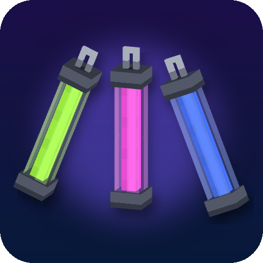
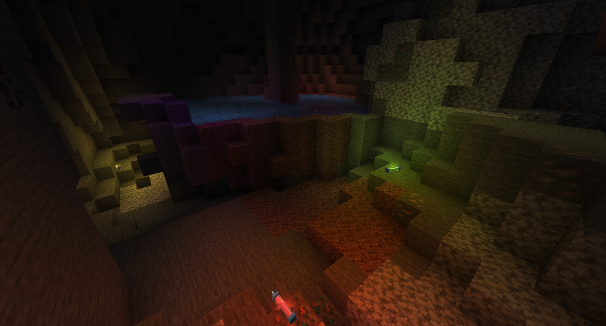

<p align="center">
  
</p>

<h1 align="center">Neon Glowsticks</h1>

<p align="center">
  <b>Throwable glowsticks</b> that bounce, roll and light up the dark with coloured light.
</p>

<p align="center">
  <a href="https://www.curseforge.com/minecraft/mc-mods/neon-glowsticks"></a>
  <a href="https://www.minecraft.net"></a>
  <a href="https://neoforged.net"></a>
  <a href="LICENSE"></a>
</p>

<p align="center">
  
</p>

## Features

- 🌈 **16 glowsticks** - one for every dye colour, 3D in hand and on the ground; the black one glows ultraviolet, the
  brown one amber.
- 🎯 **Throw them** - *Use* cracks and throws a glowstick, *Sneak* + *Use* drops it at your feet; dispensers shoot them
  too.
- 🏀 **Real physics** - they tumble, bounce off walls and mobs (high on slime blocks), roll and settle flat, sink slowly and drift with the
  current.
- 🎯 **Mark mobs** - a glowstick that hits a mob makes it glow through walls in the stick's colour and carry its
  light for 30 seconds, so you always know where it is.
- 💡 **Coloured dynamic light** that spreads like vanilla light, follows the stick in flight and lights up mobs and
  players, with a soft halo.
- ✋ **Glows in your hand** - walk through a cave with one in hand, for you, other players and mobs.
- ⏳ **Burns out** after 10 minutes with a puff of smoke; pick a stick back up and it keeps the glow it has left.
- 🛡️ **Client-side light** - nothing is placed in the world: safe for servers and other mods, mobs still spawn.

## Controls

| Action | Default |
|---|---|
| Crack and throw a glowstick | *Use* (right click) |
| Drop a glowstick at your feet | *Sneak* + *Use* |
| Pick up a thrown glowstick | *Use* on it |
| Knock a glowstick away | *Attack* (left click) on it |

## Crafting

Shapeless: **Copper Ingot** + **Glowstone Dust** or **Glow Ink Sac** + any **Dye** → 4 glowsticks of that color.

In creative mode the glowsticks are in the **Pocky Mods** and **Tools & Utilities** tabs.

## Configuration

Common config (`config/neon_glowsticks-common.toml`, also editable from the in-game mod list):

| Option | Default | |
|---|---|---|
| `glowSeconds` | 600 | how long a thrown glowstick glows |
| `markSeconds` | 30 | how long a mob hit by a glowstick stays marked (0 = no marks) |

Client config (`config/neon_glowsticks-client.toml`):

| Option | Default | |
|---|---|---|
| `lightLevel` | 13 | light level of a glowstick |
| `coloredLight` | true | tint the light with the glowstick's color |
| `coloredLightStrength` | 1.0 | how strong the tint is |
| `maxLights` | 32 | how many of the nearest glowsticks give light at once (held ones included; your own comes first) |
| `heldLight` | true | glowsticks held in a hand give light |
| `heldLightLevel` | 11 | light level of a glowstick held in a hand, and of the light on a marked mob |
| `markLight` | true | mobs marked by a glowstick carry its light |
| `halo` | true | soft glow around the sticks |

## Compatibility

[](https://modrinth.com/mod/sodium) ✅ **[Sodium](https://modrinth.com/mod/sodium)** - works, coloured light included.

[](https://www.curseforge.com/minecraft/mc-mods/embeddium) ❌ **[Embeddium](https://www.curseforge.com/minecraft/mc-mods/embeddium)** - its chunk renderer may bypass the light: sticks glow, blocks around them may stay dark.

## Installation

1. Install [NeoForge](https://neoforged.net) for Minecraft 1.21.1.
2. Put this mod into the `mods` folder.

The mod is needed on both the client and the server.

## Building

```sh
./gradlew build
```

The jar is written to `build/libs/`.

## Credits

- Author: **Pocky**.
- Sound effects are built from royalty-free sources: [Kenney](https://kenney.nl)'s Impact and Interface packs (CC0)
  and the OpenGameArt upload "Swishes Sound Pack" (CC0).

<!-- more-mods:start -->
## More mods by Pocky

**🌦️ Weather & nature**

<table>
  <tr>
    <td width="56"><a href="https://www.curseforge.com/minecraft/mc-mods/hoarfrost-snow-blizzards"></a></td>
    <td><a href="https://www.curseforge.com/minecraft/mc-mods/hoarfrost-snow-blizzards"><b>Hoarfrost: Snow & Blizzards</b></a> - seven kinds of snowfall, a living wind and soft snow on the land (<a href="https://github.com/Pocky-l/hoarfrost">source</a>)</td>
  </tr>
  <tr>
    <td width="56"><a href="https://www.curseforge.com/minecraft/mc-mods/petrichor-rain-storms"></a></td>
    <td><a href="https://www.curseforge.com/minecraft/mc-mods/petrichor-rain-storms"><b>Petrichor: Rain & Storms</b></a> - realistic rain, puddles, drips and branching lightning (<a href="https://github.com/Pocky-l/petrichor">source</a>)</td>
  </tr>
  <tr>
    <td width="56"><a href="https://www.curseforge.com/minecraft/mc-mods/rustling-leaves"></a></td>
    <td><a href="https://www.curseforge.com/minecraft/mc-mods/rustling-leaves"><b>Rustling Leaves</b></a> - falling leaves and leaf piles you can wade through and rake, client-side (<a href="https://github.com/Pocky-l/rustling-leaves">source</a>)</td>
  </tr>
</table>

**💡 Light**

<table>
  <tr>
    <td width="56"><a href="https://www.curseforge.com/minecraft/mc-mods/lumen-rigs"></a></td>
    <td><a href="https://www.curseforge.com/minecraft/mc-mods/lumen-rigs"><b>Lumen Rigs</b></a> - aimable spotlights and floodlights with colored light and visible beams (<a href="https://github.com/Pocky-l/lumen-rigs">source</a>)</td>
  </tr>
</table>

**🎨 Graphics & performance**

<table>
  <tr>
    <td width="56"><a href="https://www.curseforge.com/minecraft/mc-mods/turbo-for-distant-horizons"></a></td>
    <td><a href="https://www.curseforge.com/minecraft/mc-mods/turbo-for-distant-horizons"><b>Turbo for Distant Horizons</b></a> - Distant Horizons terrain generated several times faster (<a href="https://github.com/Pocky-l/dhturbo">source</a>)</td>
  </tr>
  <tr>
    <td width="56"><a href="https://www.curseforge.com/minecraft/mc-mods/pocky-shaders"></a></td>
    <td><a href="https://www.curseforge.com/minecraft/mc-mods/pocky-shaders"><b>Pocky Shaders</b></a> - a cosy, natural shader pack that sets itself up (<a href="https://github.com/Pocky-l/pocky-shaders">source</a>)</td>
  </tr>
</table>

**⚔️ Gear & gameplay**

<table>
  <tr>
    <td width="56"><a href="https://www.curseforge.com/minecraft/mc-mods/holy-staff"></a></td>
    <td><a href="https://www.curseforge.com/minecraft/mc-mods/holy-staff"><b>Holy Staff</b></a> - a healing staff with three skills and flying heal numbers (<a href="https://github.com/Pocky-l/holy-staff">source</a>)</td>
  </tr>
  <tr>
    <td width="56"><a href="https://www.curseforge.com/minecraft/mc-mods/ranchers-vacpack"></a></td>
    <td><a href="https://www.curseforge.com/minecraft/mc-mods/ranchers-vacpack"><b>Rancher's Vacpack</b></a> - a Slime Rancher vacuum gun for items and small mobs (<a href="https://github.com/Pocky-l/ranchers-vacpack">source</a>)</td>
  </tr>
</table>

**🔮 Magic**

<table>
  <tr>
    <td width="56"><a href="https://www.curseforge.com/minecraft/mc-mods/hextale"></a></td>
    <td><a href="https://www.curseforge.com/minecraft/mc-mods/hextale"><b>HexTale</b></a> - hextech magic to research, distil and bind with runes, inspired by Arcane and Thaumcraft (<a href="https://github.com/Pocky-l/HexTale">source</a>)</td>
  </tr>
</table>

**⚡ Tech & energy**

<table>
  <tr>
    <td width="56"><a href="https://www.curseforge.com/minecraft/mc-mods/mekanism-advancedgenerators"></a></td>
    <td><a href="https://www.curseforge.com/minecraft/mc-mods/mekanism-advancedgenerators"><b>Mekanism Advanced Generators</b></a> - nine tiers of solar panels, big solar generators, cubes and cables for Mekanism (<a href="https://github.com/Pocky-l/Mekanism-MoreSolarPanels">source</a>)</td>
  </tr>
</table>

**🛠️ Server tools**

<table>
  <tr>
    <td width="56"><a href="https://www.curseforge.com/minecraft/mc-mods/inventory-backups"></a></td>
    <td><a href="https://www.curseforge.com/minecraft/mc-mods/inventory-backups"><b>Inventory Backups</b></a> - inventory and ender chest backups with one-click restore for admins (<a href="https://github.com/Pocky-l/inventory-backups">source</a>)</td>
  </tr>
</table>

<!-- more-mods:end -->

## License

[MIT](LICENSE)
